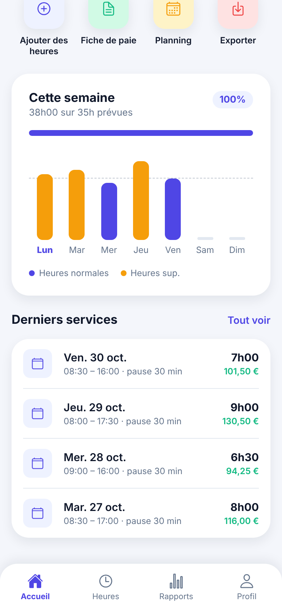

# Suivi Heures & Salaire — application mobile (React Native / Expo)

Page d'accueil de l'application de suivi des heures de travail et du salaire.

<p>
  
  
</p>

## Contenu de la page d'accueil

- **En-tête** : salutation selon l'heure, date du jour, salaire brut estimé du mois.
- **Carte de pointage** : chrono en direct, bouton *Pointer / Terminer / Reprendre*, montant gagné en temps réel.
- **Statistiques** : heures de la semaine, montant gagné, heures sup. (majorées), pauses.
- **Actions rapides** : ajouter des heures, fiche de paie, planning, export.
- **Graphique hebdomadaire** : barres par jour, ligne d'objectif quotidien, progression vers l'objectif contractuel.
- **Derniers services** : historique avec horaires, durée et montant.
- **Barre de navigation** : Accueil, Heures, Rapports, Profil.

## Lancer le projet

```bash
cd suivi-heures-salaire
npm install
npm start        # puis scanner le QR code avec l'app Expo Go
npm run web      # aperçu dans le navigateur
```

## Structure

```
App.js                     point d'entrée
src/theme.js               couleurs, espacements, formatage € / heures
src/data/mock.js           données de démonstration (taux horaire, semaine, services)
src/screens/HomeScreen.js  écran d'accueil
src/components/            ClockCard, StatCard, WeekChart, ShiftItem, QuickAction
```

Les données sont fictives (`src/data/mock.js`) : il suffira de les brancher sur le stockage
(AsyncStorage, SQLite…) ou une API pour la suite.
